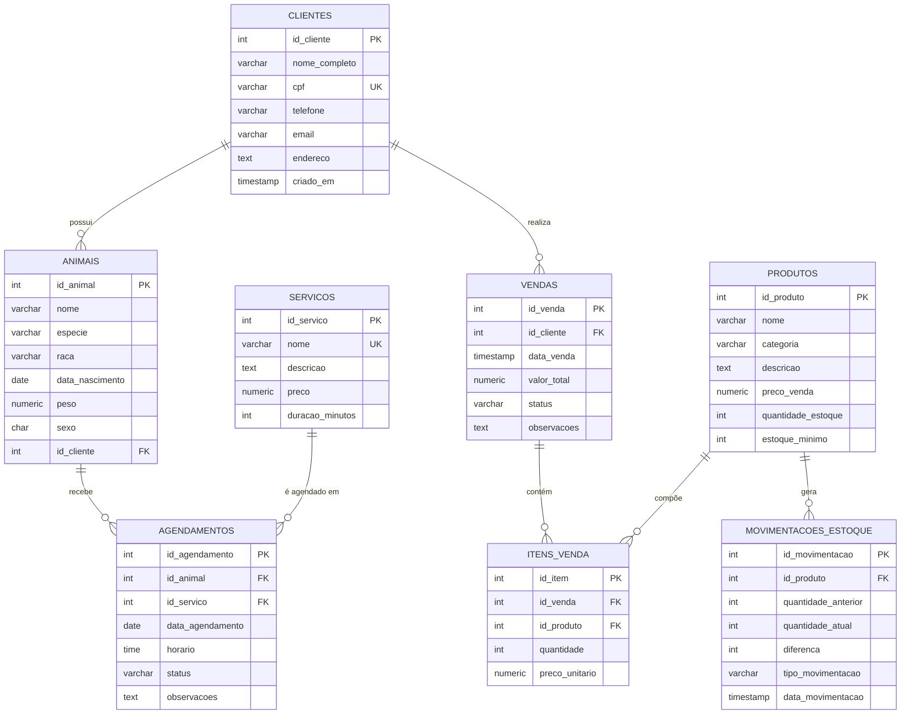

# DER — Pet Shop

Diagrama Entidade-Relacionamento do banco de dados PostgreSQL.

## Regras de integridade representadas

- Um cliente possui **vários** animais e **várias** vendas.
- Um animal pode ter **vários** agendamentos; cada agendamento refere-se a **um** serviço.
- Uma venda possui **vários** itens; cada item refere-se a **um** produto.
- Cada produto gera **várias** movimentações de estoque (via trigger).
- `vendas.status`: `pendente`, `finalizada` ou `cancelada`.
- `agendamentos.status`: `agendado`, `concluido` ou `cancelado`.
- Chaves estrangeiras usam `ON DELETE CASCADE` quando o registro filho não faz sentido sem o pai
  (animais, agendamentos, itens e movimentações) e `ON DELETE RESTRICT` para preservar histórico
  (vendas e serviços).
